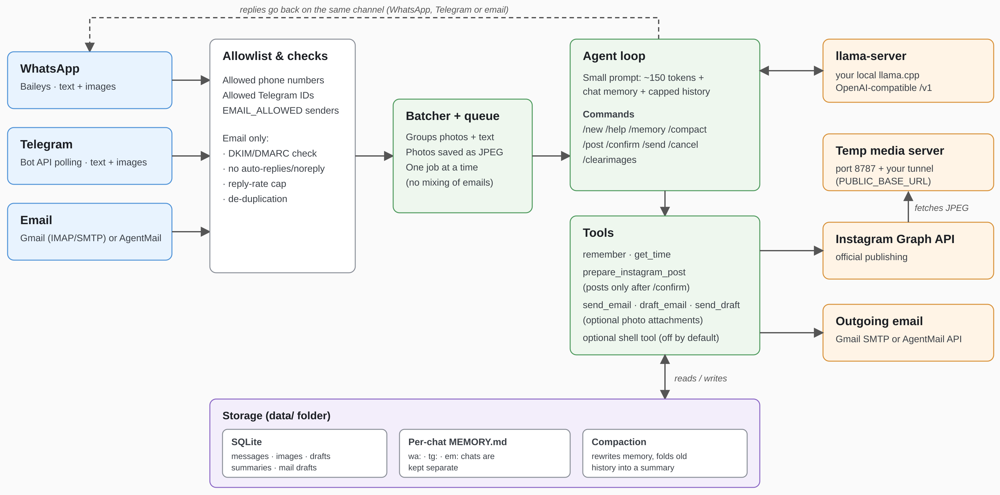

# [pawlite](https://github.com/pawlite/pawlite)

[Link to the PawLite GitHub Repository](https://github.com/pawlite/pawlite)

Tired of the security, performance and token cost issues that come with most autonomous agents, I created this [PawLite](http://www.github.com/pawlite/pawlite). It is a locally-run, llama.cpp-compatible companion designed to work with models of all sizes (7B–120B). Pawlite aims to bridge the gap between AI hype and practical reality, serving as a seamless assistant through this technological singularity era.

"PawLite is a lightweight autonomous AI agent built to combat the financial, context, and tool bloat found in assistants/agents like OpenClaw and Hermes. **WhatsApp + Telegram + Email ⇄ SQLite ⇄ your local llama.cpp server**, with
**Instagram posting**. Send photos in any channel; the agent drafts a caption and, once you confirm,
publishes the post through Instagram's official Graph API. PawLite is a highly optimized core, consisting of just ~900 lines of TypeScript, no framework, secure (running isolated in a docker container), easy to scale and add skills to.



## Why it's small on purpose
By default each request sends only a ~150-token system prompt, the chat's `MEMORY.md`, capped history, and 3 tiny tools.
Compare that with the ~70K tokens an "agent platform" sends per turn: prefill on a local model drops from tens of
seconds to a second or two.

## Setup
Requires [Node](https://nodejs.org/) 22+. You can get a recent version together with npm  [here](https://nodejs.org/en/download).

```bash
npm install
cp .env.example .env        # then edit it
llama-server -m your-model.gguf -c 8192 -np 1 --jinja --port 8080
npm run chat                # test the LLM side without any chat app
npm start
```

It's quick and easy to run your agent with npm, however following npm install you can also build (```bash docker compose build --no-cache```) and run [Docker](https://docs.docker.com/get-started/get-docker/) (recommended for security reasons) as```bash docker compose up```,```bash docker compose logs -f```to watch the logs,
```bash docker compose down -d```to run the container in a background as a daemon and```bash docker compose down```to stop the container running in the background. With [docker](https://docs.docker.com/get-started/get-docker/) your agent will run in isolation.


### WhatsApp
Set `ALLOWED_NUMBERS` (digits, country code), run `npm start`, scan the QR under
Settings → Linked Devices. (`PAIRING_PHONE` gives you a code instead of a QR. `SELF_CHAT=true` uses "Message yourself".)

### Telegram
1. Talk to **@BotFather** → `/newbot` → put the token in `TELEGRAM_BOT_TOKEN`.
2. Put your numeric user ID in `ALLOWED_TELEGRAM_IDS`. Not sure what it is? Start the bot with the list empty,
   message it, and read the `Ignored Telegram message from user id …` log line.
3. Set `WHATSAPP_ENABLED=false` if you only want Telegram.

### Email (Gmail and/or AgentMail)
The bot **polls** the mailbox (default every 120 s), answers mail from addresses in `EMAIL_ALLOWED`, and replies in the
same thread, marking handled mail as read. It answers people who write to it; it doesn't sit in your personal inbox or
send unprompted mail. Image attachments work, so you can email photos to post on Instagram, then reply `/confirm`.

**Note** If you're running the agent on your local machine, antivirus software may block nodejs from polling imap servers, like Gmail. If it happens, you'll see an error, when starting the agent. In that scenario you can disable it for a specific domain, e.g. imap.gmail.com.

**Gmail (or any IMAP/SMTP mailbox).** Create a *dedicated* account, turn on 2-Step Verification. For Gmail follow the steps below:
1. Generate a **App Password**
2. Open Google Account Security. 
3. Enable 2-Step Verification, if it isn't already enabled. 
4. Open Google App Passwords. 
5. Create a new App Password (for example, name it My TypeScript Application). 
6. Copy the generated 16-character password and use it to configure the app as described below.

Set `IMAP_USER` + `IMAP_PASSWORD`. The Gmail hosts are the defaults; for Fastmail or
your own domain, change `IMAP_HOST` / `SMTP_HOST`. If it can't connect, check that IMAP is enabled for the account.
Workspace admins can block app passwords.
Forgery check: mail is ignored if the receiving server reports DKIM/DMARC failure (`EMAIL_REQUIRE_AUTH=true`).

**AgentMail.** Create an inbox and an API key in the AgentMail console; set `AGENTMAIL_API_KEY` and
`AGENTMAIL_INBOX_ID` (the inbox address). Uses the REST API, no IMAP. AgentMail doesn't expose a sender-verification
verdict this project relies on, so only `EMAIL_ALLOWED` protects you there. Use an obscure inbox address.

Both can run at once. Safeguards: allowlist, auto-reply/bulk/`noreply` senders skipped, quoted history stripped,
de-duplication (never answers the same message twice), and a per-sender reply cap (`EMAIL_MAX_REPLIES_PER_HOUR`) to stop bot-to-bot loops.

### Instagram
Posting uses Meta's official Content Publishing API. You need:

1. An Instagram **Professional** account (Business or Creator).
2. A Meta developer app with the Instagram product ("Instagram API with Instagram Login") and an access token with the
   `instagram_business_content_publish` permission. Put the token in `IG_ACCESS_TOKEN` and the account's numeric
   Instagram ID in `IG_USER_ID`. (If your token comes from Facebook Login instead, set
   `IG_GRAPH_HOST=https://graph.facebook.com`; its permission is named `instagram_content_publish`.)
   Posting to your own account usually works while the app is in development mode; check Meta's current rules.
   Long-lived tokens expire, so plan to refresh them.
3. A **public HTTPS URL**. Instagram downloads each image from a URL you provide, so it can't read local files.
   The bot runs a tiny media server on `HTTP_PORT` (default 8787); expose it with a tunnel and set `PUBLIC_BASE_URL`:
   ```bash
   cloudflared tunnel --url http://localhost:8787     # prints https://something.trycloudflare.com
   ```
   (Quick tunnel URLs change on restart; use a named tunnel, ngrok, Tailscale Funnel or a reverse proxy for a stable one.)
   Only the images of the post being published are served, under random one-time tokens, and only while publishing.

`IG_USER_ID`, `IG_ACCESS_TOKEN` and `PUBLIC_BASE_URL` must all be set or posting stays disabled.

## Posting flow
1. Send 1–10 photos (as photos or as image files). Quick successions are batched, so albums work.
2. Say what you want: *"post these to Instagram, caption about our hike"*. The model writes a caption and creates a
   **draft**. Or skip the model with `/post <your caption>`.
3. The bot shows the exact draft. Reply **`/confirm`** to publish or `/cancel` to discard. Nothing is published without `/confirm`,
   and `/confirm` is handled by code, not by the model, so a confused or manipulated model can't post on its own.

Commands: `/post <caption>`, `/confirm`, `/cancel`, `/clearimages`, `/new`, `/help`.

Images are converted to what Instagram requires: sRGB JPEG, ≤1440px wide, under 8 MB, aspect ratio **padded** (white bars)
into the allowed 4:5–1.91:1 range rather than cropped. Carousels (2–10 images) are cropped by Instagram to the first
image's ratio. Captions are limited to 2,200 characters and 30 hashtags; Instagram allows 100 API posts per 24 hours.
Unposted images are deleted after 7 days.

Groups: in WhatsApp/Telegram groups the bot answers only when an allowed member mentions it (`@Claw` / `@your_bot`),
and a photo needs that mention in its caption. For multi-image posts, use a direct chat.

## Memory and compaction
Per chat, the bot keeps (1) conversation history in SQLite, (2) a long-term `MEMORY.md` the model writes with its
`remember` tool, and (3) a running summary of older messages. Compaction keeps (1) and (2) from growing forever.

**When it runs:** after every reply, the bot estimates the chat's size in tokens (characters ÷ `COMPACT_CHARS_PER_TOKEN`,
default 4, so it is a rough estimate, not the model's real tokenizer). If a limit is passed, it compacts that chat *after*
sending the reply. `/compact` runs it on demand, `/memory` shows what's remembered. An optional timer
(`COMPACT_INTERVAL_MINUTES`, 120 by default) also sweeps all chats, e.g. after you hand-edit a `MEMORY.md`.
- **Memory:** above `COMPACT_MEMORY_TOKENS`, the model rewrites `MEMORY.md` as a deduplicated bullet list. The rewrite is
  only accepted if it is a clean, shorter, non-trivial list, and the old file is saved as `MEMORY.md.bak`.
- **History:** above `COMPACT_HISTORY_TOKENS` of un-summarized messages, the oldest are folded into a summary (kept in the
  prompt) and only the newest `COMPACT_KEEP_MESSAGES` stay verbatim. Original rows stay in the database but are no longer
  sent. `/new` clears the history and summary but keeps `MEMORY.md`.
- Compaction goes through the same one-at-a-time queue as chat, so it never overlaps a reply, but the *next* message waits
  if a compaction is still running (a few seconds to a minute on a local model).
- If an attempt doesn't shrink a chat (model failure or a rejected rewrite), it isn't retried until the content has grown
  another 20%, so a stubborn chat can't slow every reply.
- A small local model can drop or distort facts when rewriting. That's what the backup and the acceptance checks are for.
- Independently of compaction, every request is hard-capped (last 4,000 characters of memory, `HISTORY_CHARS` of history),
  so the prompt can't overflow even if compaction hasn't run.

## Config highlights
| Var | Meaning |
|---|---|
| `LLM_THINKING=false` | Sends `enable_thinking=false` (faster on thinking models like Gemma 4). |
| `LLM_TOOLS=false` | No tool definitions. Use `/post <caption>` instead. Good if your model's tool calling is flaky. |
| `LLM_VISION=true` | Shows new images to the model (≤4, downscaled) so it can write captions. Needs a vision model and `--mmproj`. |
| `ENABLE_SHELL=true` | Gives the model a bash tool. **Only inside Docker.** |

## Docker
```bash
docker compose up --build      # scan the WhatsApp QR on first run
```
Data (auth, DB, memory, images) lives in `./data`. Point your tunnel at `http://localhost:8787`.

## Extending
- **New tool:** add a definition in `src/tools.ts:toolDefs()` and a `case` in `runTool()`.
- **Another channel:** write an adapter that calls `receive(chatId, text, images, { send })` from `src/inbound.ts`.
- **Other Instagram formats** (Reels, Stories): extend `src/instagram.ts`; the API supports them, this project doesn't yet.

## Caveats (read these)
- **Baileys is an unofficial WhatsApp Web client.** Automated use can get a number restricted or banned; use a spare number if you care.
- Telegram bot chats are not end-to-end encrypted.
- Anyone on the allowlists can talk to your model, and can publish to your Instagram with `/confirm`. Keep the lists tight.
- Not production-hardened yet: no rate limiting, images and text only (no video/Reels), no encryption of `./data`.
- Agentmail and Instagram support not fully tested yet.
- **better-sqlite3** package might give you a warning about a no-longer-supported dependency installed. It comes pre-packaged, you can ignore it and hopefully there will be a new release soon.
- Next release will focus on refactoring and improving  what is already there. Follow the [PawLite GitHub Repository](https://github.com/pawlite/pawlite) for further updates.

## License & Author

Distributed under [MIT](LICENSE) license.

[pawlite](https://github.com/pawlite/pawlite) developed by [Yuki Ichinoseki](https://github.com/pawlite)
